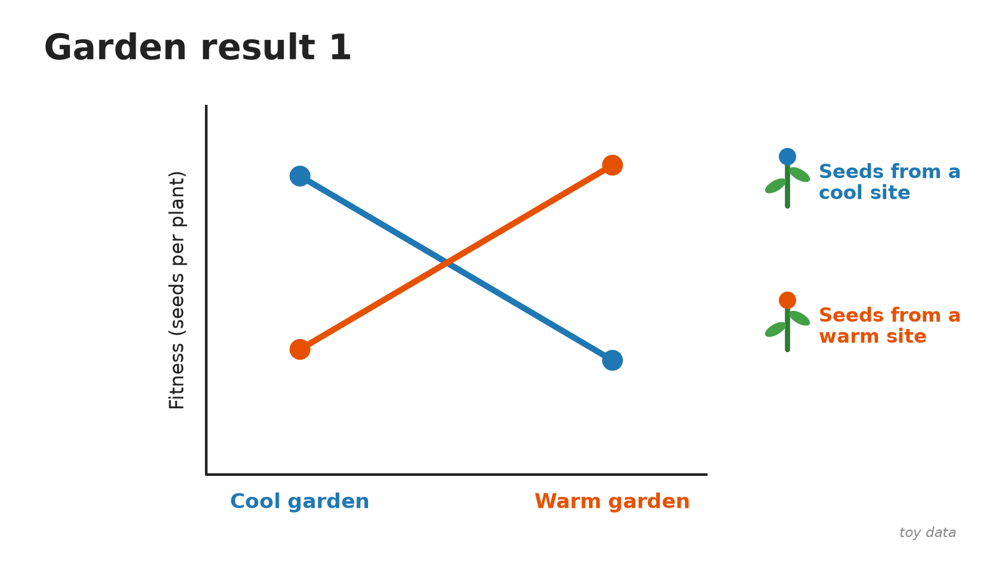
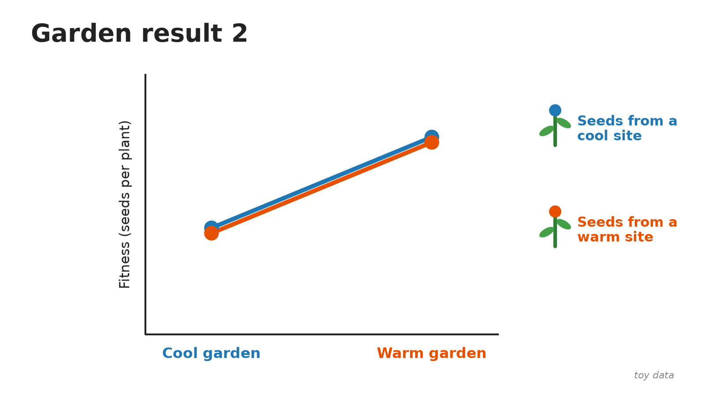
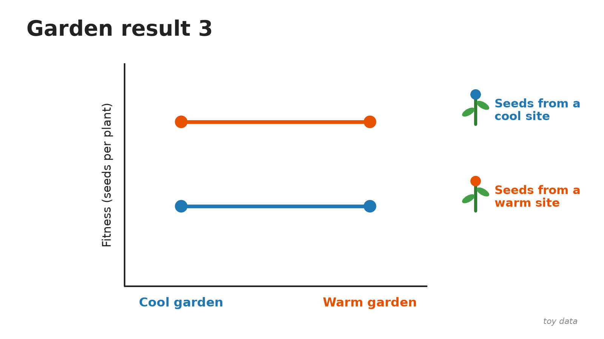
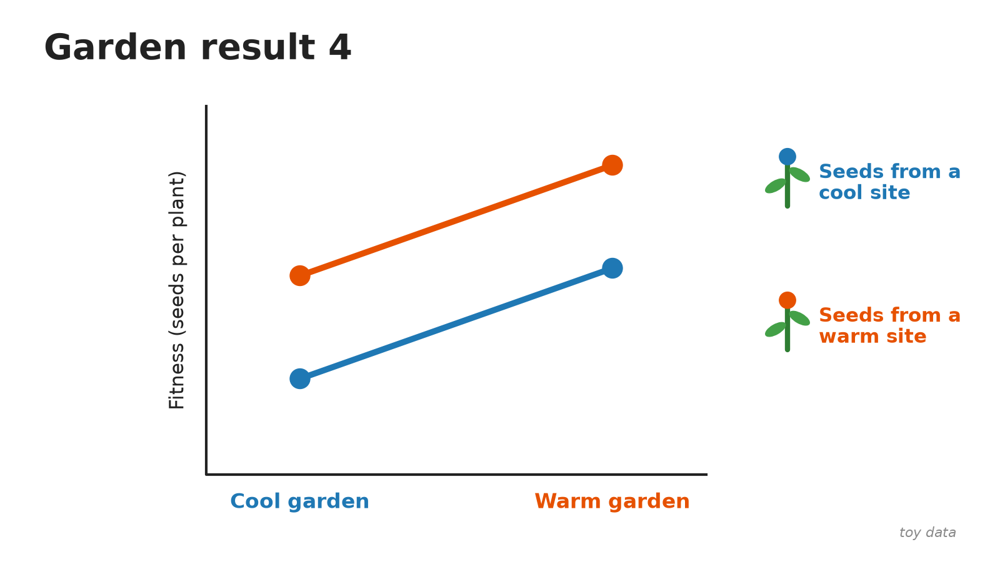

This is the "Read the garden" game from the Nov 5 climate adaptation lecture, set up for self-study.

**The setup.** Seeds come from two populations of the same species: one collected at a **cool** site (blue) and one collected at a **warm** site (orange). Both are grown in two common gardens, one cool and one warm. Each graph shows the average fitness (seeds per plant) of each population in each garden. A line connecting a population's two gardens is its **reaction norm**: how its phenotype changes with the environment.

**How to read a reaction norm graph.**

- **The two lines are at different heights** (in at least one garden): the populations differ **genetically**. They're in the same garden, so the difference can't be the environment.
- **The lines slope:** the same genotype does differently in different environments. That's **plasticity**.
- **The lines cross, and each population does best in its own home garden:** **local adaptation**. Native genotypes outperform foreign genotypes. This is what reciprocal transplant experiments test for.

For each graph, choose one:

1. Local adaptation
2. Genetic difference, no local adaptation
3. Plasticity only (no genetic difference)
4. Genetic difference + plasticity, no local adaptation

The numbers are made up (toy data) so that each pattern is easy to see.

## Garden result 1

::: {.callout-tip collapse="true" title="Answer"}
**Local adaptation.** The lines cross. The cool-site population has the highest fitness in the cool garden, and the warm-site population has the highest fitness in the warm garden. Each population does best at home. Which population is "better" depends on the environment (a genotype-by-environment interaction).
:::

## Garden result 2

::: {.callout-tip collapse="true" title="Answer"}
**Plasticity only (no genetic difference).** The two populations perform identically in each garden: the lines sit on top of each other. Both do better in the warm garden, so the environment changes the phenotype, but the populations don't differ genetically.
:::

## Garden result 3

::: {.callout-tip collapse="true" title="Answer"}
**Genetic difference, no local adaptation.** The warm-site population has higher fitness in *both* gardens, so the populations differ genetically. The lines are flat, so there's no plasticity. And because the same population wins in both gardens, this isn't local adaptation: one population is simply better everywhere.
:::

## Garden result 4

::: {.callout-tip collapse="true" title="Answer"}
**Genetic difference + plasticity, no local adaptation.** Both lines slope upward: both populations do better in the warm garden, which is plasticity. The warm-site population is higher in both gardens, which is a genetic difference. The lines are parallel and never cross, so the same population wins everywhere. That rules out local adaptation.
:::

## A real example

The lecture's real-data version of graph 1 is a five-year reciprocal transplant of *Arabidopsis thaliana* between Italy and Sweden ([Ågren & Schemske 2012, *New Phytologist*](https://doi.org/10.1111/j.1469-8137.2012.04112.x)). The local population had higher fitness than the nonlocal one in 8 of the 10 site-by-year comparisons, with no significant difference in the other two. See the [Nov 5 slides](slides/2026-11-05_climate-adaptation.pdf).
